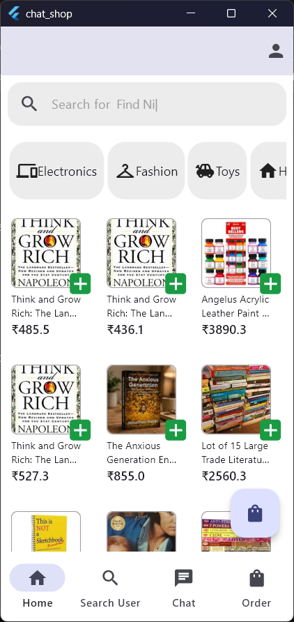
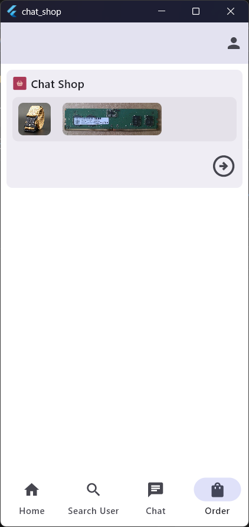
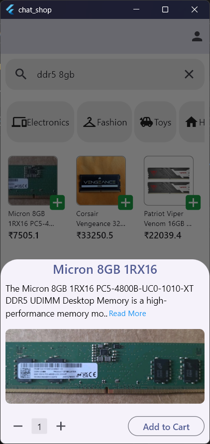
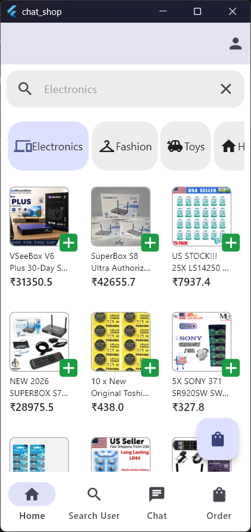
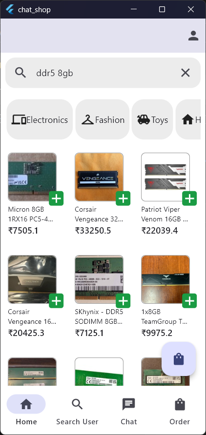
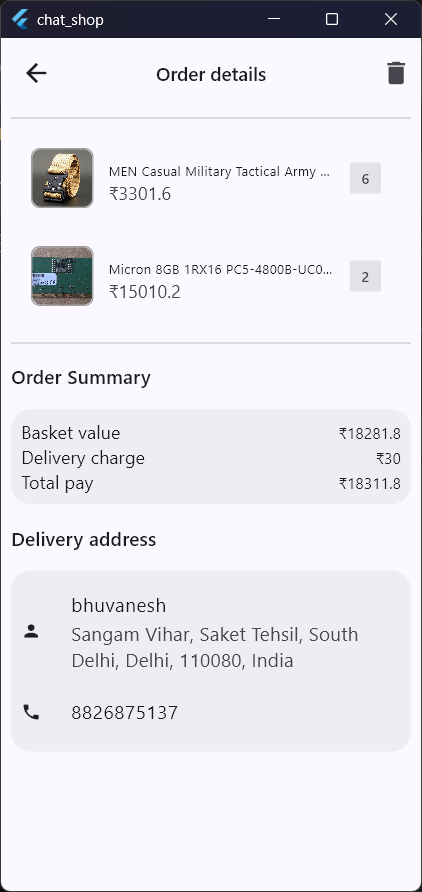
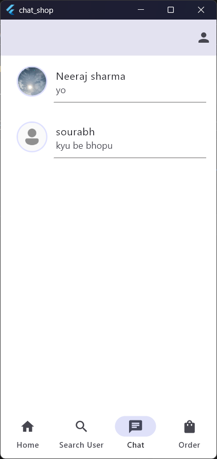
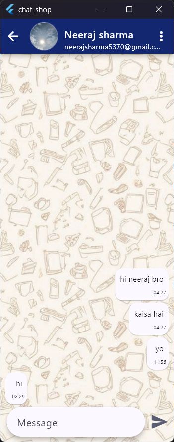
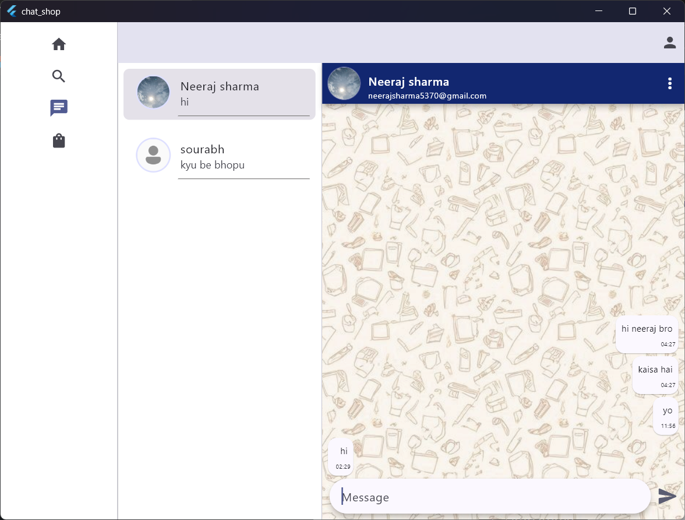

<div align="center">

#  chat_shop

**A Flutter app that combines real-time chat, live eBay product search, and location-aware ordering — with a fully adaptive UI.**


</div>

---

##  About

`chat_shop` is a personal Flutter playground built to explore, test, and refine features, architectures, and UI flows for learning and skill improvement.

---

##  Key Features

| Feature | Description |
|---|---|
|  **Authentication Flow** | Complete custom Signup and Login pages. |
|  **Google Integration** | "Link with Google" button that securely initializes and fetches the user's Gmail profile data. |
|  **1-on-1 Chat System** | Search for other registered users and chat privately in real time, with a dedicated Chat History page. |
|  **Live eBay Integration** | Dynamic search bar that fetches and displays real product data from the official eBay API. |
|  **Location-Aware E-Commerce** | Full Cart and Order system that captures and uses real-time GPS coordinates. |
|  **Currency Conversion** | Converts USD prices to INR using a dedicated currency service. |
|  **Adaptive UI** | Responsive layout that adjusts seamlessly to different screen sizes and orientations. |

---

##  Screenshots

###  Shopping

<table>
  <tr>
    <td align="center"><b>Home</b><br></td>
     <td align="center"><b>Order View</b><br></td>
    
  </tr>
  <tr>
    <td align="center"><b>Item Details</b><br></td>
     <td align="center"><b>Category Selected</b><br></td>
     <td align="center"><b>Search Item</b><br></td>
    <td align="center"><b>Order Detail</b><br></td>
  </tr>
</table>

###  Chat

<table>
  <tr>
    <td align="center"><b>Chat History</b><br></td>
    <td align="center"><b>Chat View</b><br></td>
  </tr>
</table>

###  Adaptive / Desktop Layout

The UI seamlessly adjusts across different screen sizes.

<p align="center">
  
</p>

---

##  Architecture & Project Structure

```text
lib/
├── src/
│   ├── core/
│   │   ├── layout/          # Responsive scaffold components
│   │   └── services/        # Currency service (converts USD rate to INR)
│   ├── features/            # Modular app features (Search Items, Cart, Search Users, Orders, Chat, etc.)
│   └── app.dart             # Responsive layout wrapper (AppLayout)
├── firebase_options.dart    # Firebase auto-generated config
└── main.dart                # App entry point
```

The project follows a **feature-first** structure: each feature is self-contained, while shared pieces (layout, services) live in `core/`.

---

##  Getting Started


### Installation

```bash
# 1. Clone the repository


# 2. Install dependencies
flutter pub get

# 3. Configure Firebase
flutterfire configure

# 4. Run the app
flutter run
```


##  Tech Stack

- **Framework:** Flutter & Dart
- **Backend:** Firebase (Auth, real-time database for chat)
- **Auth:** Email/Password + Google Sign-In
- **APIs:** eBay Browse API, currency conversion service
- **Device:** GPS / location services

---


<div align="center">

 If you found this project useful, consider giving it a star!

</div>
